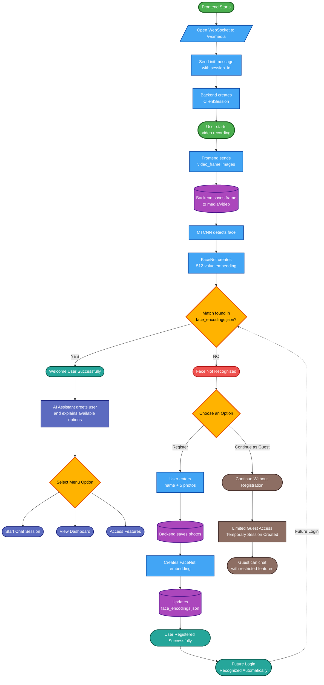

# 📦 Project Setup

## 1️⃣ Create Virtual Environment

```bash
python -m venv .venv
```

---

## 2️⃣ Activate Virtual Environment

### Windows

```bash
.\.venv\Scripts\activate
```

---

## 3️⃣ Install Required Dependencies

```bash
python -m pip install -r requirements-app.txt
```

# 🔑 Environment Variables

Create a `.env` file in the root directory:

```env
GROQ_API_KEY=your_groq_key
Elevens_lab_key=your_elevenlabs_key
```

# ▶️ Running the Project

## 🚀 Start Backend

```bash
cd d:\gpu-avatar-backend-pipeline-liva-x1
.\.venv\Scripts\python.exe main.py
```

## 💻 Start Frontend

```bash
cd d:\gpu-avatar-backend-pipeline-liva-x1\client
npm run dev
```

# 📌 Requirements

- Python 3.10 or above
- Node.js installed
- npm installed

# ⚠️ Important Notes

- Start backend before frontend
- Ensure `.env` is configured
- Install all dependencies successfully
